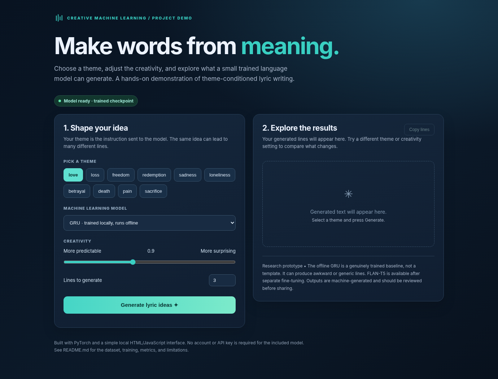

# Theme to Lyric

## What is this project?

I decided to make a machine learning project that generates lyric ideas from a theme. I have always enjoyed music, and learning to play guitar made me appreciate songwriting even more. So I thought it would be interesting to see if I could train a model to come up with a line based on something I give it, like love, freedom, or loss.

The main question I wanted to answer was pretty simple: **Does telling a model what theme to write about actually make a difference in what it generates?**

The user can choose a theme in the website, pick how many lines they want, and adjust how creative the output should be. After clicking **Generate lyric ideas**, the model produces short lines based on what it learned during training.

This is meant to be a tool for coming up with ideas, not something that replaces a songwriter. Some lines sound better than others, which is also part of what I wanted to study.

## How to run the demo

The easiest way to try the project is to use the model I already trained. The checkpoint is included in the repository, so you do not have to train anything or download a dataset just to run the demo.

You will need Python 3.11 (recommended), a terminal, and a web browser. The demo runs on your computer using the CPU, so a GPU is not required.

### 1. Download the project

Open this repository on GitHub, click **Code**, and choose **Download ZIP**. Unzip it and open Terminal inside the extracted project folder. You can also clone it with Git:

~~~bash
git clone https://github.com/andrewwrenn1/theme_to_lyric.git
cd theme_to_lyric
~~~

Make sure you are in the folder that contains **demo.py**, **offline_model.py**, and **requirements-demo.txt**.

### 2. Set up Python

For Mac or Linux:

~~~bash
python3.11 -m venv .venv
source .venv/bin/activate
~~~

If your computer has a compatible Python version under the command python3 rather than python3.11, you can use python3 in that first command.

For Windows PowerShell:

~~~powershell
py -3.11 -m venv .venv
.\.venv\Scripts\Activate.ps1
~~~

If PowerShell does not allow activation, open Command Prompt and run:

~~~bat
.venv\Scripts\activate.bat
~~~

### 3. Install what the demo needs

~~~bash
python -m pip install -r requirements-demo.txt
~~~

This installs PyTorch, which is used to load and run the trained model. The exact dependency version is listed in **requirements-demo.txt**. If you need a different PyTorch build for your computer, see the [official PyTorch installation page](https://pytorch.org/get-started/locally/).

### 4. Start the website

~~~bash
python demo.py
~~~

Open this address in Safari, Chrome, or another browser:

**http://localhost:8501**

Now you can choose a theme, choose between one and five lines, adjust the creativity setting, and press **Generate lyric ideas**. There is also a button to copy the results.

Keep Terminal open while you are using the demo. Press **Control + C** in Terminal when you want to stop it.

If port 8501 is already being used, run:

~~~bash
python demo.py --port 8502
~~~

Then go to **http://localhost:8502**.

### Check that everything is working

From the main project folder, you can also run:

~~~bash
python -m unittest discover -s tests -v
~~~

These tests check things like loading the model, generating text, loading the website, and using the generation endpoint. The repository also runs these tests through GitHub Actions.

## How does the model work?

The working demo uses a **GRU (Gated Recurrent Unit)** model made with PyTorch. A GRU is a kind of neural network that works with sequences of information. In this case, the information is words.

I chose this smaller model because I wanted something I could actually train, test, and run on a regular computer. It learns patterns from lyric lines and uses those patterns to predict what word could come next.

Here is the basic idea. If I choose **freedom** in the GUI, the model receives a special token that represents freedom. It then predicts words one at a time until it finishes a short line. If I choose **love**, it starts with a different theme token.

The model contains learned word embeddings, a GRU layer, and a layer that predicts the next word. The word vocabulary and trained weights are saved in **checkpoints/offline_best.pt**. The GUI loads that checkpoint using **offline_model.py**.

The creativity slider changes the sampling temperature. Lower temperatures tend to favor more likely words, while higher temperatures allow more variety. That can make the output more interesting, but sometimes it also makes it less understandable.

There is also an optional FLAN-T5 model in the code. That is a different and larger type of model. The included GRU is the model used for the finished demo and the reported experiment results. FLAN-T5 needs its own training before it can be selected in the demo.

## Where did the data come from?

I used song lyrics from the [Genius song lyrics dataset on Hugging Face](https://huggingface.co/datasets/Dr3dre/Genius-song-lyrics-cleaned). The dataset-building code downloads the file **data/train-00003-of-00032.parquet** from that source.

I wanted the model to learn the relationship between a theme and a lyric line. The problem is that the original lines did not already have the ten theme labels I needed. So I used **Qwen2.5-0.5B-Instruct**, a smaller language model, to help find common themes and assign labels to lines.

The ten themes are **love, loss, freedom, redemption, sadness, loneliness, betrayal, death, pain, and sacrifice**. A lyric line can have more than one theme.

The data was cleaned to remove things like section labels and duplicate lines. I then separated songs into training, validation, and testing groups so lines from the same song would not appear in multiple groups.

Here is the dataset used for the project:

| Data split | Lyric lines | Different songs |
| --- | ---: | ---: |
| Training | 10,000 | 4,585 |
| Validation | 1,000 | 527 |
| Testing | 1,000 | 515 |

The split check found no songs shared between the three sets. The full counts are in **experiments/data_audit.json**.

One issue I had to consider is that the theme labels were generated by another model rather than checked by people. That means some labels can be wrong or themes can overlap. For example, loss, pain, and sadness can be difficult to separate. That is important when looking at the results.

### Getting the training data

The public GitHub repository does not include the full lyric text because the original songs belong to their writers and publishers. You **do not** need these files to run the demo, but you **do** need them to repeat the training experiments.

If you have the original files from this project, put them in the **data** folder with these names:

~~~text
data/train.jsonl
data/val.jsonl
data/test.jsonl
data/meta.json
data/themes.json
~~~

The first three are the training, validation, and testing sets. The last two contain information about the data and the themes.

If you want to rebuild the data instead, first install the full requirements:

~~~bash
python -m pip install -r requirements.txt
~~~

Then run:

~~~bash
python make_dataset.py all --out data --seed 13 --songs 8000 --groups 400 --train 10000 --val 1000 --test 1000 --batch-size 16
~~~

This downloads the source data and the Qwen model, discovers themes, assigns labels, and creates the train/validation/test files. It can take a while, especially without a GPU. You can also run each step separately using **pool**, **discover**, **label**, and **build**. To see the options, run:

~~~bash
python make_dataset.py --help
~~~

Because the source data and downloaded models can change, rebuilding everything might not produce exactly the same dataset. The original labeling method also calculated some thresholds using the whole candidate pool. A better future version would calculate those thresholds using only training data.

## Training my model

For the main experiment, I trained the GRU for **five epochs** using **4,000 lines** selected from the training split. Since some lines had more than one theme, those lines gave me **7,718 training pairs**.

I used a vocabulary of **2,400 tokens**, an embedding size of **64**, a hidden size of **96**, a batch size of **64**, and a learning rate of **0.002**. The random seed was **13**.

During training, the model learned by comparing its predicted next word with the actual next word. This used cross-entropy loss and the AdamW optimizer. At the end of each epoch, I checked the validation loss and saved the model with the lowest validation loss. The test set was kept separate until evaluation.

To repeat that training using the restored dataset files:

~~~bash
python offline_model.py train --data-dir data --epochs 5 --max-train-lines 4000 --max-val-lines 1000 --vocab-size 2400 --embed-dim 64 --hidden-dim 96 --batch-size 64 --lr 0.002 --seed 13 --out checkpoints/offline_best.pt
~~~

This writes the trained weights to **checkpoints/offline_best.pt** and the training history to **checkpoints/offline_best.training.json**.

To check the dataset splits:

~~~bash
python offline_model.py data-check --data-dir data --out experiments/data_audit.json
~~~

You can also generate a few lines from the saved model without starting the website:

~~~bash
python offline_model.py generate --checkpoint checkpoints/offline_best.pt --theme love --count 3 --seed 13
~~~

## How I tested whether the theme helped

I did not want to base the whole project on whether I thought a few generated lines sounded good. I wanted to see if there was a measurable difference between using a theme and not using one.

So I trained **two versions of the same GRU model**. The first received the selected theme. The second used a generic theme token, so it did not know which theme was being requested. I kept the other main settings the same.

To train the comparison model:

~~~bash
python offline_model.py train --data-dir data --epochs 5 --max-train-lines 4000 --max-val-lines 1000 --vocab-size 2400 --embed-dim 64 --hidden-dim 96 --batch-size 64 --lr 0.002 --seed 13 --unconditional --out experiments/unconditional_best.pt
~~~

After training, I measured both models on the held-out test data. I used **perplexity**, which tells me how surprised the model is by the actual words. Lower is generally better.

I also tested theme matching with a separate **TF-IDF and logistic regression classifier**. That classifier tried to identify the theme of a generated line. Since it was trained using the same automatically created labels, I treated it as a rough comparison rather than a perfect judge.

### Results

| What I measured | Without theme | With theme |
| --- | ---: | ---: |
| Validation perplexity | 98.80 | **96.68** |
| Test perplexity | 88.90 | **85.59** |
| Theme matched by the classifier | 7.5% | **22.5%** |
| Theme mean reciprocal rank | 0.285 | **0.425** |

The model that received a theme did better on both of these measures. Its test perplexity was lower, and the classifier was more likely to connect its generated lines to the requested theme.

That does **not** mean it writes perfect lyrics. Some lines are generic or do not make much sense. The theme classifier also made mistakes when checked against the test labels. But the experiment does suggest that providing a theme affects the model's output.

The exact results are saved in **experiments/offline_metrics.json**, **experiments/unconditional_metrics.json**, and **experiments/theme_probe.json**. The written explanation is in **Documents/final_report.pdf**.

### How to repeat the evaluation

With the three data split files in **data/**, run:

~~~bash
python offline_model.py evaluate --data-dir data --checkpoint checkpoints/offline_best.pt --out experiments/offline_metrics.json
python offline_model.py evaluate --data-dir data --checkpoint experiments/unconditional_best.pt --out experiments/unconditional_metrics.json
~~~

For the extra theme-matching experiment, install the full requirements and run:

~~~bash
python -m pip install -r requirements.txt
python experiments/theme_probe.py --data-dir data --count-per-theme 20 --out experiments/theme_probe.json
~~~

The experiment compares 20 generated lines for each of the ten themes from each model.

## The FLAN-T5 part of the project

I also kept my original code for experimenting with **FLAN-T5**. Unlike the smaller GRU, FLAN-T5 is a pretrained transformer model that can be fine-tuned for text generation.

The FLAN-T5 work is in **theme_to_lyric.py**. This code supports training, generating examples, and comparing a base model with a fine-tuned version. It also uses **MiniLM** to measure how closely generated lines relate to themes.

The FLAN-T5 experiments are an additional part of the project, not the source of the GRU results in the report. A trained FLAN-T5 checkpoint is not included.

To install everything needed for this part, use:

~~~bash
python -m pip install -r requirements.txt
~~~

You can also use the Conda environment:

~~~bash
conda env create -f environment.yml
conda activate theme-to-lyric
~~~

To fine-tune FLAN-T5-small:

~~~bash
python theme_to_lyric.py train --model google/flan-t5-small --data-dir data --epochs 5 --lr 3e-4 --batch-size 8 --eval-batch-size 16 --device cpu
~~~

The script uses validation loss to choose the best checkpoint and saves it under **runs/flan-t5-small/best/**. The first run downloads the pretrained model, so internet access is needed.

After training, generate lines without training again:

~~~bash
python theme_to_lyric.py train --model google/flan-t5-small --generate-only --themes love freedom --device cpu
~~~

Compare the original FLAN-T5-small and the fine-tuned checkpoint:

~~~bash
python theme_to_lyric.py evaluate --models google/flan-t5-small runs/flan-t5-small/best --data-dir data --device cpu --samples-per-theme 10
~~~

That saves comparison results in the **evaluation** folder. These are different models with different tokenizers, so their perplexity scores should not be directly compared to the GRU numbers.

## Where everything is in the repository

Here are the main files and what they do:

| File or folder | Purpose |
| --- | --- |
| **demo.py** | Runs the local website and handles requests |
| **web/index.html** | The actual interface the user sees |
| **offline_model.py** | Training, evaluation, and generation for the GRU |
| **checkpoints/offline_best.pt** | The trained model used in the demo |
| **make_dataset.py** | Downloads, cleans, and labels the source data |
| **theme_to_lyric.py** | Optional FLAN-T5 training and evaluation |
| **data/meta.json** and **data/themes.json** | Information about the dataset and themes |
| **experiments/** | Model results, the comparison model, and evaluation code |
| **Documents/** | Final report and project images |
| **tests/test_project.py** | Tests for the model and GUI |
| **requirements-demo.txt** | Dependencies for the ready-to-run demo |
| **requirements.txt** | Dependencies for the full experiments |
| **environment.yml** | Conda setup option |

The demo itself does not depend on the training data files, but retraining and reproducing all of the experiments does.

## What I learned and what I would improve

One of the biggest things I learned is that having a model generate text is not the same thing as proving that it understands what you asked for. A generated line might sound good, but I still need some way to measure whether it follows the theme.

My comparison showed that giving the model a theme made a difference. At the same time, there are improvements I would make if I continued the project. I would want more human-checked theme labels, more training data, and more comparisons with larger models like FLAN-T5.

I would also want actual people to read the generated lines and rate how well they match the chosen theme. The numbers I measured were useful, but there is still a difference between a classifier saying that a line matches a theme and a person thinking it is a good lyric.

Overall, this project gave me experience preparing a dataset, training a neural network, evaluating it, and connecting a working model to a GUI that someone else can use.

## Resources

- [Genius song lyrics dataset](https://huggingface.co/datasets/Dr3dre/Genius-song-lyrics-cleaned)
- [Qwen2.5-0.5B-Instruct](https://huggingface.co/Qwen/Qwen2.5-0.5B-Instruct)
- [FLAN-T5-small](https://huggingface.co/google/flan-t5-small)
- [all-MiniLM-L6-v2](https://huggingface.co/sentence-transformers/all-MiniLM-L6-v2)
- [PyTorch](https://pytorch.org/)
